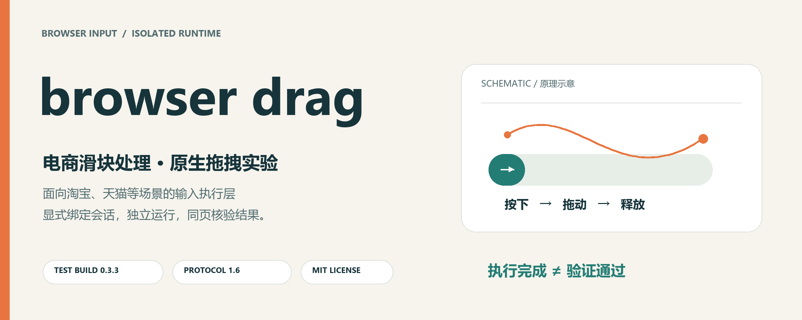
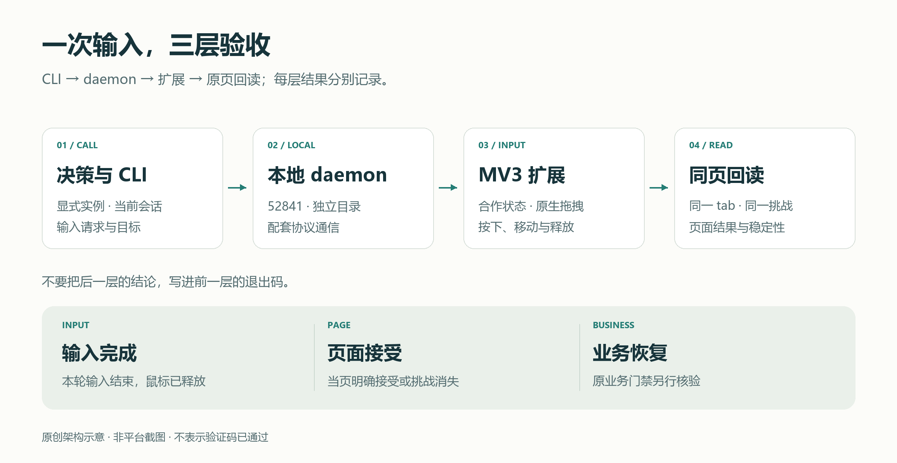
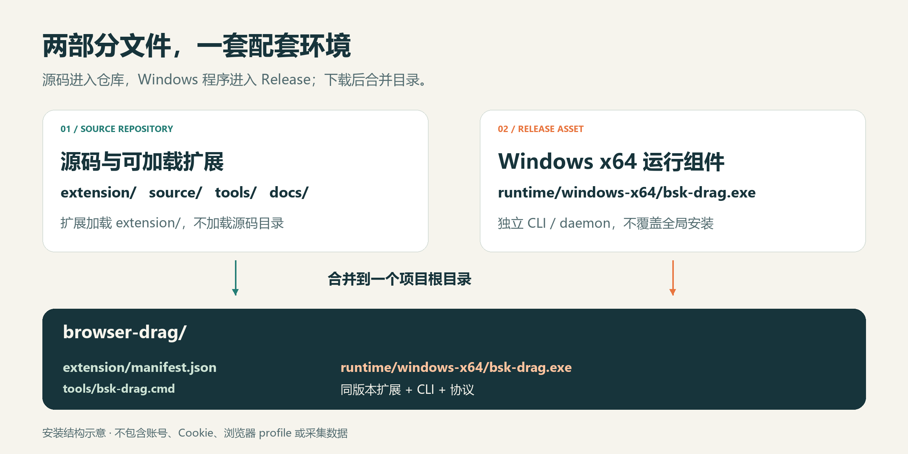

<p align="center">
  
</p>

# browser drag

**专注于淘宝、天猫等电商平台滑块验证问题的处理与调试。**

browser drag 基于 [Tencent/BrowserSkill](https://github.com/Tencent/BrowserSkill)，将原生鼠标拖拽、线性与 Bezier 曲线轨迹，以及配套 CLI/daemon 独立封装，便于接入电商浏览器自动化流程。

它聚焦的是**滑块处理的浏览器输入执行层**：把一次明确的拖拽送到正确的浏览器会话，再对同一页面回读核验。它不是淘宝、天猫官方产品，也不是安装后自动识别、自动通过各种验证码的服务。

**导航：** [项目定位](#项目定位) · [功能](#功能一览) · [架构](#工作原理) · [安装](#快速开始) · [版本](#版本与兼容性) · [测试](#测试与验证) · [常见问题](#常见问题) · [使用限制](#使用限制) · [免责声明](#免责声明)

**入口：** [下载配套运行组件](https://github.com/1515215956-afk/browser-drag/releases/tag/drag-test-0.3.3-20261110) · [完整安装说明](docs/INSTALL.md) · [安全与隐私](SECURITY.md) · [参与贡献](CONTRIBUTING.md)

---

## 项目定位

电商自动化遇到滑块时，问题往往不只是“鼠标往右拖一下”：

- 拖动发生在另一个 profile、错误的标签页或过期的页面上。
- 扩展、CLI 与协议版本混用，界面看起来正常但动作链路没有接通。
- 鼠标按下后遇到取消、超时或人工接管，没有可靠地处理释放状态。
- 接口返回成功，却把“输入完成”误当成“平台验证通过”。

browser drag 将这些容易混淆的环节拆开：**显式会话 → 原生拖拽 → 释放确认 → 同页验收**。

### 面向哪些场景？

| 场景 | 当前定位 |
| --- | --- |
| 淘宝、天猫页面出现滑块验证 | 本项目重点面向的处理与调试场景；每次挑战仍需当页核验 |
| 自有或明确获授权的普通拖动控件 | 用于验证浏览器原生拖拽链路、取消及释放行为 |
| 其他电商网站的滑块 | 可评估通用拖拽执行能力；没有逐平台适配或通过率承诺 |
| 图形拼图、缺口识别、多步骤验证 | 当前公开包不包含对应的自动识别模型或通用求解器 |

用户自己的商品采集、SKU 选型、账号调度和恢复门禁不在本仓库中。这个独立项目不替代那些采集流程。

## 功能一览

| 能力 | 实现与说明 |
| --- | --- |
| 原生鼠标拖拽 | 鼠标按下、连续移动、释放，通过 BrowserSkill 会话和扩展输入链路执行 |
| 两种轨迹 | 线性路径与有界 Bezier 路径；曲线变化是输入参数，不是真人身份或验证通过的证明 |
| 可复现的轨迹种子 | 记录 seed 后可复现路径，便于调试和回归 |
| 参数与可见区域检查 | 对非法参数、过期引用、越界路径等进行检查，而不是盲目发送输入 |
| 取消与释放处理 | 对取消、期限和释放失败保留明确结果，不把未知效果当成成功 |
| 会话与合作状态 | 沿用 BrowserSkill 的会话、借用、人工接管与停止机制 |
| 独立配套环境 | 测试扩展、CLI/daemon、协议成套匹配，避免覆盖现用官方安装 |
| 可审计的导出包 | 源码、扩展与配套程序有 SHA-256 来源记录，可离线验收 |

## 工作原理



1. 调用方选择正确的测试扩展实例，并明确绑定会话与当前目标。
2. CLI 将输入请求交给本机独立 daemon；扩展在相应浏览器会话中执行原生鼠标动作。
3. 动作返回后，调用方核对释放状态，并重新读取**同一标签页、同一挑战**的状态。
4. 页面验证状态与后续业务状态分别记录，不自动推断账号已经全面恢复。

**三个结果分别看：**

| 层级 | 回答什么问题 | 不能据此推出什么 |
| --- | --- | --- |
| 输入完成 | 本轮拖拽是否结束，鼠标是否释放？ | 不直接推出平台接受验证 |
| 页面接受 | 同页是否显示接受结果，挑战是否消失且状态稳定？ | 不直接推出账号以后免验证 |
| 业务恢复 | 原业务流程的登录、数据质量和风险检查是否通过？ | 不应跳过原业务门禁 |

本页图片均为原创的项目原理图和安装结构图，**不是电商平台截图，也不是验证码通过证明**。

## 快速开始

### 1. 准备两部分文件

你需要的是**源码仓库 + 配套运行组件**，不是两套不同的插件。



| 文件来源 | 取得什么 | 放在哪里 |
| --- | --- | --- |
| [本仓库](https://github.com/1515215956-afk/browser-drag) | `extension/`、`source/`、`tools/`、文档与清单 | 同一个项目根目录 |
| [Release](https://github.com/1515215956-afk/browser-drag/releases/tag/drag-test-0.3.3-20261110) | `BrowserSkill-Drag-windows-x64-20261110.zip` | 解压后把其中 `runtime/` 合并到项目根目录 |
| 同一 Release | ZIP 对应的 `.sha256` 文件 | 用于校验下载的组件包 |

可以通过 Git 克隆，也可以使用仓库的 **Code → Download ZIP**：

```powershell
git clone https://github.com/1515215956-afk/browser-drag.git
cd browser-drag
```

合并后的关键结构应为：

```text
browser-drag/
├─ extension/
│  └─ manifest.json
├─ runtime/
│  └─ windows-x64/
│     └─ bsk-drag.exe
├─ source/
├─ tools/
│  ├─ bsk-drag.cmd
│  └─ verify_release.py
└─ README.md
```

### 2. 校验组件与项目文件

在下载组件 ZIP 的目录中执行：

```powershell
Get-FileHash .\BrowserSkill-Drag-windows-x64-20261110.zip -Algorithm SHA256
```

将结果与 Release 的 `.sha256` 文件比较。合并目录后，在项目根目录执行：

```powershell
python tools/verify_release.py --require-runtime
```

这个命令校验文件完整性，不启动浏览器，也不发送鼠标动作。只有查看源码、尚未下载 runtime 时，可先运行 `python tools/verify_release.py`。

### 3. 加载测试扩展

在目标 Chromium profile 的扩展管理页开启开发者模式，选择**加载已解压的扩展程序**，指向项目根目录里的 **`extension/`**。

加载后名称仍为 **`BrowserSkill Drag Test (isolated)`**。仓库名称是 browser drag，保留原测试扩展名称是为了准确识别已有配套产物，不在这次文档更新中悄悄修改扩展。

### 4. 启动独立服务

在一个 PowerShell 终端中执行，并保持该终端运行：

```powershell
.\tools\bsk-drag.cmd daemon-start
```

在另一个终端中查询连接和接口：

```powershell
.\tools\bsk-drag.cmd browsers --json
.\tools\bsk-drag.cmd drag --help
```

包装入口固定独立端口 `52841`、独立运行目录，并设置 `BSK_AUTO_START=0`。Windows 优先使用 `.cmd`，无需为了运行本项目而调整系统 PowerShell 执行策略。

### 5. 绑定实例，再进入业务流程

使用查询得到的**测试扩展实例**，创建显式绑定的会话：

```powershell
.\tools\bsk-drag.cmd session start --browser BROWSER_INSTANCE_ID --json
```

`BROWSER_INSTANCE_ID` 是占位符，需要替换为上一步实际查到、且已核对 profile 的实例。原版与测试版插件的实例 ID 不通用。页面借用、人工接管和输入授权继续遵循当前扩展设置。

实际动作使用新鲜的页面观察与目标引用，不复用文档或旧日志里的坐标、refs 和会话 ID。完整操作与清理见 [安装说明](docs/INSTALL.md)。

## 版本与兼容性

| 项目 | 当前配套值 |
| --- | --- |
| 测试扩展 / CLI | `0.3.3` |
| 协议 | `1.6` |
| 独立 daemon 端口 | `52841` |
| 预编译运行组件 | Windows x64 |
| 扩展声明的最低 Chromium | `125`；不代表所有后续版本和浏览器壳均已逐一测试 |
| 扩展名称 | `BrowserSkill Drag Test (isolated)` |
| 独立运行目录 | `%LOCALAPPDATA%\BrowserSkillDragStandalone\bsk-home` |
| 源码与扩展校验 | `PROVENANCE.json` 与 `RELEASE_FILES.json` |

**本项目不是官方 BrowserSkill 0.4.1 更新版。** 不要将本测试扩展与官方 0.4.1 的 CLI/daemon 交叉配对，也不要覆盖全局 `bsk.exe`。端口被占用时先核对占用者，不停止未知服务。

## 测试与验证

验证记录要与“通用验证码成功率”分开理解：

| 已有证据 | 可以说明什么 |
| --- | --- |
| 2026-11-10：原拖拽与轨迹相关离线单元测试 49/49 通过 | 参数检查、轨迹、取消、释放、会话与输入分发的相关分支通过该组测试 |
| 原生普通控件隔离链路测试 | CLI → daemon → 扩展 → 普通拖动控件的执行链路曾通过测试 |
| 公开包 SHA-256 与 Release 下载回读 | 发布组件与保留的配套产物一致 |
| 本次首页与文档更新 | 文档、链接、图像和导出清单验收；未进行新的线上验证码测试 |

公开包没有随附账号截图、原始会话或平台挑战数据，因此不把历史页面现象包装成可复现的通用通过率。详见 [测试说明](docs/TESTING.md)。

## 常见问题

### 这是不是安装后就能自动过所有淘宝、天猫滑块？

不是。公开包包含输入执行能力及配套组件；挑战识别、目标判断、调用时机与结果判定需要调用方接入。平台是否接受仍需同页核验。

### 为什么要下载运行组件，不能只装扩展？

扩展是执行端，CLI/daemon 是本地调用与通信端。它们通过配套协议工作；只装其中一个，不等于整条链路已经接通。

### 为什么项目叫 browser drag，扩展仍叫 Drag Test？

仓库展示名称与现有扩展产物名称分开。本次只完善开源说明，保留已有程序和扩展字节，避免文档改版意外改变现用环境。

### 曲线、随机变化是否等于模拟真人、降低风控或保证通过？

不等于。它们是可测试的路径参数，不是平台认可、免风控或真人身份的证明。本项目没有相应成功率保证。

### 为什么会话有了，鼠标还是没有动作？

先区分扩展启用、daemon 连接、实例绑定、页面借用与当前合作状态。插件开着不等于当前页面已经由 Agent 控制；遇到人工接管、拒绝或未知输入效果时应先检查状态，而不是循环重发。

### 小窗口里按钮被浮层遮挡怎么办？

先核对实际窗口与视口尺寸、目标可见性，再评估操作。尺寸请求成功不代表浏览器外壳已真正调整窗口；不要把遮挡或坐标问题误写为页面缺货、加购成功或验证失败。

### 能直接替换我原有的 BrowserSkill 和采集 skills 吗？

这份独立包不负责迁移原采集规则，也不自动改配置。保留原环境，使用独立测试实例，并遵守单个标签页的独占控制交接。

### 如何停止和退出？

先结束自己的会话并归还借用页面，再运行 `tools/bsk-drag.cmd daemon-stop` 停止本项目独立服务；按需在目标 profile 中禁用测试扩展。不要删除浏览器 profile 或原 `.bsk` 来代替清理。

## 使用限制

本项目面向自有或明确获授权的自动化测试、兼容性排查与输入链路研究。使用者应自行核对平台协议、适用规则及实际授权，不将公开源码视作网站或账号的访问许可。

- 不用于未经授权的账号访问、批量注册、撞库、刷量、恶意抢购、欺诈或其他滥用。
- 不将本项目作为规避网站访问控制、平台安全机制或账号管理规则的授权依据。
- 遇到登录要求、人工接管、验证拒绝、访问异常或不明输入效果，应停止相关动作并核对状态；不要无限循环、自动刷新或复用旧页面证据。
- 不在 Issue、截图或日志中提交 Cookie、token、手机号、收货地址、完整浏览器 profile 或其他敏感资料。
- 不对所有电商网站、挑战类型、账号状态和浏览器版本作兼容性或通过率承诺。

详见 [完整使用边界与免责声明](DISCLAIMER.md) 和 [安全与隐私说明](SECURITY.md)。

## 免责声明

本项目按 [MIT License](LICENSE) 以现状形式发布，在适用法律允许的范围内，不对适销性、特定用途适用性、不侵权、持续可用性、验证码通过率或账号状态作保证。软件可能存在缺陷，平台页面与验证逻辑也可能随时变化。

使用本项目可能带来操作失败、账号限制、业务中断或数据损失等影响。使用者应先在可控环境中评估与验证。相关责任限制以有效许可及适用法律为准；这份说明不是“免责一切”的承诺，也不排除法律规定不得排除的责任。

本仓库不是淘宝、天猫或其他电商平台的官方产品。对上游 Tencent/BrowserSkill 的引用和版权保留不表示上游对本分支用途或效果作出背书。完整说明见 [DISCLAIMER.md](DISCLAIMER.md)。

## 贡献与反馈

欢迎提交可复现的普通控件拖拽问题、协议兼容性问题、文档改进与测试用例。反馈时说明组件版本、操作系统、浏览器版本、复现步骤和已脱敏的输出，清楚区分“输入完成”和“页面接受”。

普通问题通过 [Issues](https://github.com/1515215956-afk/browser-drag/issues) 反馈；漏洞和可能含敏感信息的问题先按 [SECURITY.md](SECURITY.md) 处理。提交代码前请阅读 [CONTRIBUTING.md](CONTRIBUTING.md)。

## 来源与许可

本项目基于 [Tencent/BrowserSkill](https://github.com/Tencent/BrowserSkill)，遵循 [MIT License](LICENSE)，保留 Copyright (c) 2026 Tencent。完整本地 fork 源码、来源基线与变更边界见 [UPSTREAM.md](UPSTREAM.md) 和 [PROVENANCE.json](PROVENANCE.json)。

第三方依赖继续受各自许可约束。仓库中的图像为项目原理插图，SVG 源文件与 PNG 一并保留在 `docs/images/`，不含真实账号、平台验证截图或用户采集资料。
